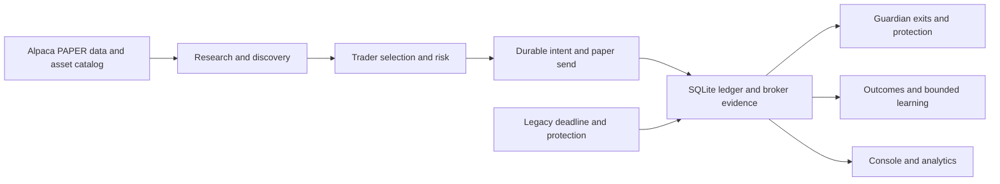

# Elrond simplification design

The November 4 directive makes the HP OMEN's deployed PAPER system, including
its newer dashboard and deadline releases, the behavioral baseline. Git main
lags deployed source. The repair branch preserves that source before changing
it. The user wants less work per cycle, reliable paper execution, visible
accounting and diagnostics, and retained learning evidence. No performance
quota can substitute for a validated out-of-sample edge.

## Measured baseline and operating boundaries

- Host `LEANNES-LAPTOP` has C: and D:, no E:. Authoritative repository and
  releases are under `D:/Elrond`; repair worktree is
  `D:/Elrond/worktrees/runtime-repair`. New operational scripts go with the
  established D: project topology because requested E: is absent.
- Source inventory: 2,389 tracked files, 381 source Python files, 486 maintained
  code/assets, 118,413 nonblank/noncomment source lines, 13 direct production
  dependencies. Definitions and full file/edge map in `source-baseline.json` and
  `tracked-file-inventory.json`; these exclude test and prose lines.
- Seven registered services, 35 descendant processes including launchers. One
  ten-second closed-session sample: 8.99% of machine CPU, 878,223,360 bytes
  working set, 1,205,371,646 logical bytes read and 288,375,970 logical bytes
  written. These counters do not measure physical disk throughput or DB growth.
- Operating SQLite is 131,318,099,968 bytes, WAL mode, 4,096-byte pages and zero
  freelist pages. A five-sample indexed read probe took 0.003–0.041 ms, which
  does not represent write latency. `EXPLAIN QUERY PLAN` shows the active
  deadline's broad signals and events reads scan and use temp B-trees for ORDER BY.
- Current core can make repeated risk-bounded US-equity PAPER attempts and research
  outside market hours. Crypto market wiring exists elsewhere but is excluded by
  the active core. Six slots of retained legacy protection/deadline authority are
  not assumed removable without an ownership ledger audit.
- The learner considered 147 closed gross-paper outcomes and properly rejected
  three candidates. No accepted predictive edge or full native per-fill fee
  accounting exists. The active dashboard has truthful daily account-fee evidence;
  native trade net remains unknown.

## Architecture and proposed approach

Keep the modular monolith and three core roles. Repair hot queries and entry
readiness before changing service count. Preserve the active dashboard and
deadline deltas as exact source, not a wholesale old-release overwrite. Make
console controls same-origin and make cost reads bounded with explicit
unavailable status. Keep raw trade/fee/receipt histories and accepted IDs.
Historic closed-session transition currently fences entry until fresh open-
session evidence authorizes resume. Do not silently weaken that authority to
claim an after-hours deployment.

Alternatives considered: a new service/database would add coordination and
storage without measured need; a wholesale rewrite would discard verified
paper/ledger authority; deleting legacy tasks immediately would risk owned exits.
Incremental query and control repairs are the supported path.

## Phase boundaries

1. Commit preserved deployed source and bounded baseline; retain one worktree.
2. Replace broad deadline history replay with relevant SQL selection and tests
   that retain every due exit/reconciliation and failed handoff. Measure query
   plans and cycle I/O before/after on isolated fixtures.
3. Protect every console control POST with a shared local intent boundary;
   preserve legitimate local stop/resume. Bound report reads without publishing
   partial financial totals. Improve visible fee/blocker explanations.
4. Simplify duplicated script bootstraps only if release packaging and role
   startup tests prove identical behavior. Delete dead code only with complete
   entrypoint, dynamic loader, migration, recovery and task-reference evidence.
5. Assess crypto addition, learning improvements, fee allocation and current
   owner retirement as separately verified behavior changes. No fee allocation
   is represented as exact without source evidence or an explicit pooled rule.
6. Run focused and full isolated checks, compare measurements, then controlled
   cutover with one authoritative writer, verified rollback and live PAPER
   observation. No irreversible DB compaction before historical projection
   completeness and quiesced-copy validation.

The task remains incomplete until relevant service releases are actually
deployed and observed. A good local test does not establish trading performance.
